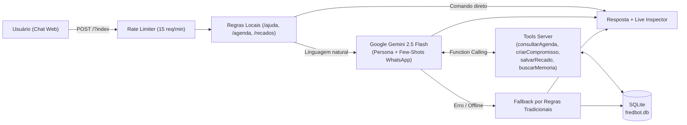

# 📄 Documento Executivo de Entrega — FredBot OS (PersonaBot Tech)

> **Instituição:** Instituto Federal Farroupilha (IFFarroupilha)  
> **Curso:** Técnico em Informática Integrado ao Ensino Médio (Concluintes)  
> **Disciplina:** Tópicos Emergentes da Informática  
> **Professor:** Luiz Rafael Jacques Caldeira (`luiz.caldeira@iffarroupilha.edu.br`)  
> **Equipe:** Murilo Jaques, Daniel Guerra e João Vitor  

---

## 1. Sobre a Empresa (`Projeto_criando_agente_de_IA.pdf`)

1. **Nome da empresa:** PersonaBot Tech  
2. **Área de atuação:** Tecnologia da Informação — Desenvolvimento de Agentes Conversacionais Autônomos e Gêmeos Digitais Personalizados.  
3. **Produtos ou serviços:** Criação de assistentes virtuais sob medida treinados/calibrados com dados reais de comunicação do usuário, capazes não só de conversar com a personalidade do cliente, mas de executar tarefas reais em agendas, recados e bases de conhecimento.  
4. **Público-alvo:**
   - **Usuários finais (Interlocutores):** Amigos, colegas de banda (*Orquídea Negra*), colegas do curso Técnico em Informática Integrado ao Ensino Médio e parceiros de RPG que precisam falar com uma pessoa ocupada.
   - **Clientes/Administradores:** Pessoas com rotina sobrecarregada (estudantes concluintes do técnico integrado, músicos, profissionais de TI) que desejam delegar triagem de mensagens e agendamentos.
5. **Problema ou necessidade:** O **Frederico** está na reta final de conclusão do curso **Técnico em Informática Integrado ao Ensino Médio** no IFFarroupilha, sobrecarregado entre entregas da matéria de Tópicos Emergentes da Informática (IA), provas finais do colégio e ensaios musicais, acumulando mensagens sem resposta e desencontros de horários com a turma.

---

## 2. Sobre o Agente de IA

1. **Nome do agente:** **FredBot OS (Fred IA)**  
2. **Objetivo principal:** Atuar como o Gêmeo Digital autônomo do Frederico, respondendo os amigos no tom exato dele, consultando/agendando compromissos, registrando recados com prioridade e resgatando memórias da turma.  
3. **Quem utilizará o agente?**
   - **Amigos e colegas:** Enviam mensagens e comandos pelo chat (*Janela 1*).
   - **Frederico (Administrador):** Acompanha e confirma compromissos pendentes ou marca recados como lidos na *Central do Fred* (*Janela 2*).
4. **Como será a interação?** Texto em interface web desktop em tempo real (*FredOS Desktop*), com possibilidade futura de extensão para voz.  
5. **Principais Funcionalidades (6 implementadas):**
   1. **Consulta de Agenda (`consultarAgenda`):** Verifica compromissos e horários livres por data/hora no SQLite.
   2. **Agendamento Autônomo (`criarCompromisso`):** Marca novos rolês, ensaios ou reuniões com status inicial `pendente_aprovacao`.
   3. **Gestão de Recados (`salvarRecado`):** Grava recados no SQLite com prioridade `normal` ou `urgente` e permite marcá-los como lidos no painel.
   4. **Memória Histórica via RAG (`buscarMemoria`):** Pesquisa histórias reais, gírias e piadas internas da turma em `memoria_fatos`.
   5. **Mimetização de Estilo (Few-Shot Learning):** Injeta diálogos reais extraídos de 8 arquivos `.zip` do WhatsApp (`scripts/extrair_dialogos_whatsapp.py` $\rightarrow$ `app/data/few_shots.ts`).
   6. **Modo Híbrido (Regras Tradicionais + IA):** Comandos determinísticos locais (`/ajuda`, `/agenda`, `/recados`, `/status`) e fallback offline por regras caso a IA falhe.

6. **Exemplos de Comandos:**
   - `"/agenda"` *(regra tradicional instantânea — consulta direta no SQLite)*
   - `"E aí Dani, tudo tranquilo? Bora marcar um futebol na quarta-feira às 19h?"` *(consulta agenda e cria compromisso)*
   - `"Você tem horário livre amanhã à tarde pra gente estudar pra prova de Tópicos Emergentes?"` *(consulta agenda)*
   - `"Fred, anota um recado urgente: avisa quando puder me devolver a calculadora científica."` *(salva recado urgente)*
   - `"Fred, conta aí por que o nome da banda é Orquídea Negra se a logo é roxa?"` *(busca memória no SQLite)*
   - `"Dá tua opinião de especialista: peço xis coração ou xis bacon hoje à noite?"` *(resposta com persona)*

7. **Ações Reais Executadas ("O agente NÃO pode apenas conversar"):**
   - Leitura e gravação real em banco relacional **SQLite** (`data/fredbot.db`) nas tabelas `agenda`, `recados` e `memoria_fatos`, exibidas ao vivo no *Live Inspector* (*Janela 3*).

---

## 3. Planejamento Técnico, Segurança e Limitações

- **Dados:** Exports reais do WhatsApp (`msg/*.zip`, +15.000 mensagens processadas em 1.797 pares de diálogo) e base de fatos (`memoria_fatos`); `agenda` e `recados` iniciam vazios no SQLite.
- **Ferramentas:** 4 declarações de *Function Calling* no Gemini + motor local de regras (`rules.server.ts`).
- **API:** Google Gemini (`gemini-2.5-flash`) via `@google/generative-ai`.
- **Banco de Dados:** SQLite nativo do Node.js (`node:sqlite` em `data/fredbot.db`).
- **Memória:** Memória de longo prazo no SQLite (`memoria_fatos`) + janela de histórico recente da conversa.
- **Segurança & Controle:**
  - Novos compromissos criados pela IA entram como **`pendente_aprovacao`**, exigindo confirmação humana do Fred na Central do Fred.
  - Regras rígidas de sistema impedem vazamento de senhas, dados bancários ou criação de dívidas.
  - Controle de requisições (*Rate Limiter* de 15 req/min) e proteção de segredos via `.env` + `.gitignore`.
- **Limitações:**
  - Não realiza pagamentos ou transações financeiras.
  - Não envia mensagens reais diretamente pelo WhatsApp oficial sem integração externa de mensageria.
  - Não aprova eventos críticos automaticamente para `confirmado` (depende da ação do Fred na Central).

### Desenho da Arquitetura

---

## 4. Checklist do Trabalho Final (`_Do_chatbot_tradicional_ao_chatbot_com_IA.pdf` — Entrega: 7 de dezembro)

- [x] **Interface funcional:** Desktop *FredOS* responsivo com 3 janelas e botões de aprovação/leitura.
- [x] **Integração com IA:** Google Gemini com *System Prompt*, *Few-Shots* do WhatsApp e histórico.
- [x] **Duas+ funcionalidades adicionais:** Agenda, Recados com prioridade, Memória RAG e Extrator WhatsApp.
- [x] **Combinação de regras tradicionais com IA:** Comandos `/ajuda`, `/agenda`, `/recados`, `/status` e fallback offline.
- [x] **Tratamento de erros e controle de requisições:** Validação de entrada, `try/catch`, timeout, tradução de erros da API, `ErrorBoundary` e *Rate Limiter*.
- [x] **Organização do código e README:** Estrutura modular TypeScript/Remix + documentação completa.
- [x] **Repositório GitHub:** Publicado em `https://github.com/jxs-m/fredbot-os` com `.gitignore` seguro protegendo `.env`, banco local, chats e documentos internos.

---

## 5. Roteiro Sugerido para o Pitch (Até 5 Minutos)

- **0:00 – 1:00 | Murilo (A Empresa e o Problema):** Apresenta a *PersonaBot Tech*, o problema real do Frederico sobrecarregado e por que um chatbot tradicional de `if/else` não bastava para imitar um amigo.
- **1:00 – 2:00 | Daniel (O Agente e o Corpus Real):** Explica o *Fred IA*, o público-alvo e como extraíram mais de 15.000 mensagens reais do WhatsApp (`scripts/extrair_dialogos_whatsapp.py`) para calibrar o tom via *Few-Shot Learning*.
- **2:00 – 3:00 | João Vitor (Arquitetura Híbrida, Segurança e Limitações):** Mostra o diagrama: Regras Tradicionais (`/agenda`, fallback) + Gemini + Function Calling + SQLite + Rate Limit + Segurança (`pendente_aprovacao`).
- **3:00 – 5:00 | Equipe (Demonstração ao Vivo em `http://localhost:3000`):**
  1. Enviar `/agenda` (mostrar regra tradicional instantânea no Live Inspector).
  2. Enviar `"E aí Dani, bora marcar futebol na quarta às 19h?"` (mostrar `consultarAgenda` + `criarCompromisso` criando o card na Central do Fred e confirmar com `✓ Confirmar`).
  3. Enviar `"Fred, anota um recado urgente: devolve a calculadora pro Murilo"` e marcar como lido na Central.

